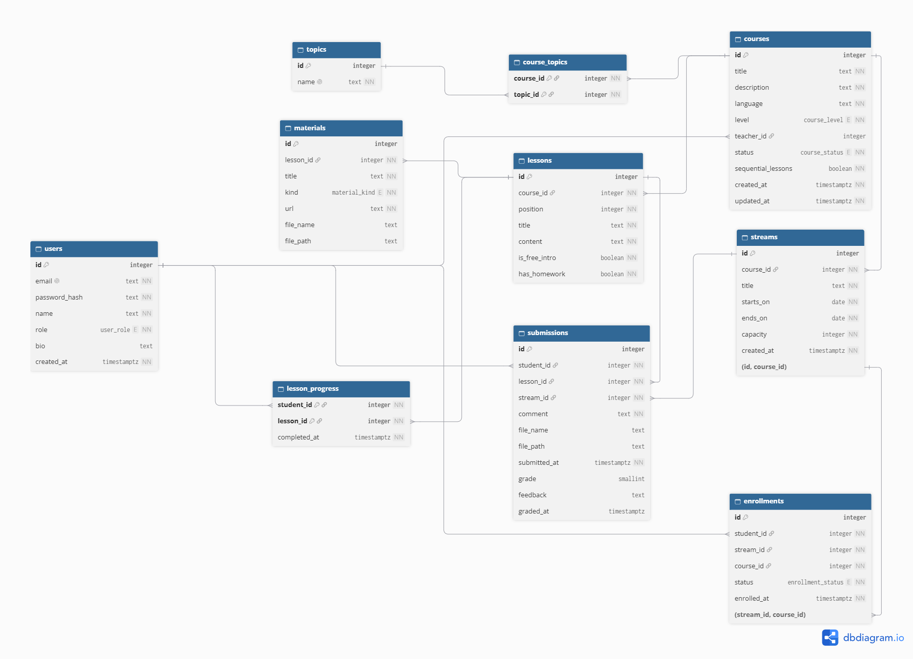
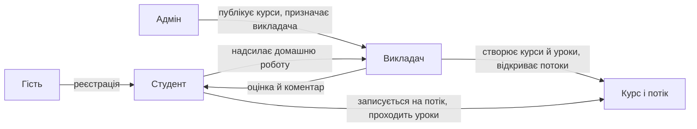
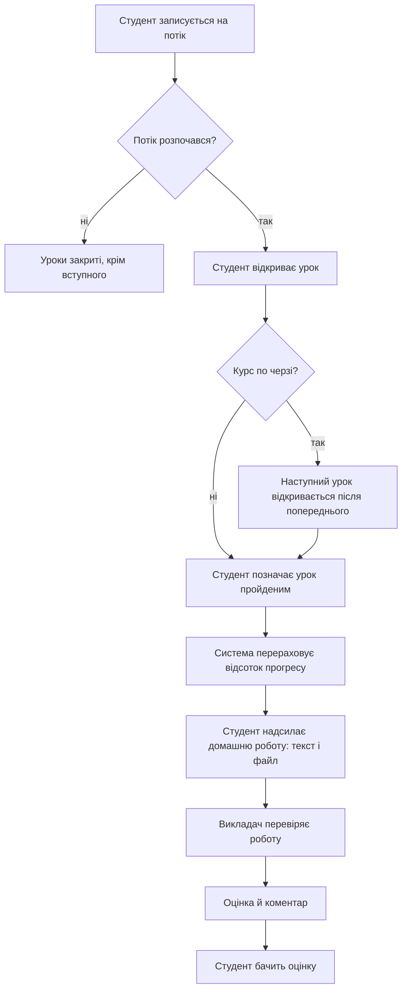

# LMS — платформа онлайн-курсів

[](https://github.com/AlexandraKurylo/lms/actions/workflows/ci.yml)

Курси з уроками, матеріалами та відстеженням прогресу. Потоки мають обмежену кількість місць, запис на них — конкурентна операція: останнє місце дістається лише одному студенту.

Репозиторій: https://github.com/AlexandraKurylo/lms

## Стек технологій

| Шар         | Технології                                 | Призначення                                          |
| ----------- | ------------------------------------------ | ---------------------------------------------------- |
| Клієнт      | React 18, Vite, TypeScript, TanStack Query | Інтерфейс, запити до API, кешування відповідей       |
| Сервер      | Node.js, Express 5, zod, jose              | API, перевірка вхідних даних, токени сесії           |
| База даних  | PostgreSQL 16, Prisma 6                    | Зберігання даних, міграції, блокування рядка потоку  |
| Тестування  | Vitest, supertest, Playwright              | Модульні й інтеграційні тести, наскрізний сценарій   |
| Розгортання | Docker, GitHub Actions, Render             | Контейнери, автоматична перевірка, публічний хостинг |

## Ролі та можливості

| Роль     | Що може                                                                                                                                                                              |
| -------- | ------------------------------------------------------------------------------------------------------------------------------------------------------------------------------------ |
| Гість    | Дивиться каталог із пошуком і фільтром за темою, відкриває сторінку курсу та вступний урок                                                                                           |
| Студент  | Записується на потік і скасовує запис, проходить уроки після старту потоку, позначає їх пройденими, бачить відсоток прогресу, надсилає домашні роботи текстом і файлом               |
| Викладач | Створює курси та уроки, вільно редагує їх, відкриває потоки з обмеженою кількістю місць, бачить студентів потоку з прогресом, перевіряє домашні роботи й ставить оцінки з коментарем |
| Адмін    | Публікує або знімає курси з публікації, призначає викладача курсу                                                                                                                    |

Правила, які перевіряє сервер:

- на потоці не більше місць, ніж задано, навіть при одночасних записах (рядок потоку блокується, див. ADR 0004);
- студент не може мати два активні записи на один курс;
- повторний запис із тим самим заголовком `Idempotency-Key` повертає збережену відповідь і не створює другий запис (ADR 0014);
- студент може прикріпити до домашньої роботи файл (документи, зображення, архіви, код, до 10 МБ), викладач його скачує;
- викладач додає до уроку матеріали: посилання, відео, статті та файли до 10 МБ; файли бачать лише студенти з доступом до уроку, а файл вступного уроку відкритий усім;
- уроки курсу закриті, поки потік не розпочався, а в курсах «по черзі» наступний урок відкривається після попереднього;
- чужий ресурс повертає 404, а не 403 (ADR 0013).

## Схема бази даних



Інтерактивна схема: [dbdiagram.io](https://dbdiagram.io/d/6ae27416ed134e407e36e97d).

На схемі показано 10 основних таблиць. Службові таблиці `refresh_tokens` (одноразові токени оновлення сесії) і `idempotency_keys` (ключі ідемпотентності запису на потік) на неї не винесено, разом у базі 12 таблиць.

## Взаємозв'язок ролей



## Проходження уроків і оцінювання



## Швидкий старт у Docker

Потрібен лише Docker Desktop.

1. Скопіюйте `.env.example` у `.env` і за потреби змініть `JWT_SECRET` (щонайменше 32 символи).
2. Запустіть все:

   ```bash
   docker compose --profile app up -d --build
   ```

   Піднімуться база, API (міграції застосовуються самі) і веб-інтерфейс.

3. Наповніть базу демо-даними:

   ```bash
   docker compose --profile app run --rm -e NODE_ENV=development api node dist/db/seed.js
   ```

4. Відкрийте http://localhost:8080.

Зупинити: `docker compose --profile app down`. Разом із даними: `docker compose --profile app down -v`.

## Публічне посилання

Розгорнуту версію можна відкрити тут: https://lms-p949.onrender.com. Демо-акаунти описано нижче. Безкоштовний тариф хостингу засинає без запитів, тому перший запит може тривати близько хвилини; файли, завантажені на сайті, не зберігаються між перезапусками. Розгортання описано в [docs/deploy.md](docs/deploy.md).

## Демо-акаунти

Пароль усіх акаунтів: `Demo12345!`

| Роль     | Пошта                                           |
| -------- | ----------------------------------------------- |
| Адмін    | admin@example.com                               |
| Викладач | teacher01@example.com … teacher10@example.com   |
| Студент  | student001@example.com … student200@example.com |

Сид створює 40 курсів, 80 потоків, 500 уроків і 800 записів. Два курси повністю реальні: «Python для аналізу даних» і «C++ на живому проєкті: SAMSKRTA».

## Розробка без Docker для API і клієнта

У Docker працює лише база, а сервер і клієнт запускаються локально. Потрібен Node.js 22 або новіший.

```bash
cp .env.example .env
docker compose up -d

cd server
npm install
npm run db:migrate
npm run db:seed
npm run dev
```

В іншому терміналі:

```bash
cd client
npm install
npm run dev
```

Клієнт: http://localhost:5173, API: http://localhost:4000/api. Запити `/api` клієнт проксує на сервер.

## Перевірки

```bash
cd server
npm run typecheck
npm run lint
npm run api:lint
npm run format:check
npm test

cd ../client
npm run typecheck
npm run lint
npm run build
```

Типи відповідей клієнта генеруються зі специфікації. Після зміни `openapi/openapi.yaml` виконайте у `client`:

```bash
npm run api:types
```

і закомітьте оновлений `src/shared/api/schema.d.ts`. CI (`npm run api:types:check`) падає, якщо файл не збігається зі специфікацією (ADR 0016).

Тести сервера працюють із реальною PostgreSQL, тому Docker із базою має бути запущений. Серед них є тест на паралельні записи на останнє місце.

### Наскрізний тест (Playwright)

Сценарій у `e2e/tests/enrollment.spec.ts` проходить шлях студента в справжньому браузері: реєстрація, пошук курсу, запис на потік, проходження двох уроків, прогрес 100 %, а другий студент бачить, що місць немає. Курс, уроки й потік створюються через API від імені викладача й адміністратора з сиду, тому тест не залежить від випадкових демо-даних.

Перед запуском потрібні база з міграціями та сидом і зібраний клієнт:

```bash
docker compose up -d db
cd server && npm ci && npm run db:deploy && npm run db:seed && npm run build
cd ../client && npm ci && npm run build
cd ../e2e && npm install && npm run install:browser && npm test
```

Playwright сам запускає API (`server/dist`) з роздачею `client/dist` і читає змінні з кореневого `.env`. Щоб перевірити вже розгорнутий сайт, задайте `E2E_BASE_URL`. У CI тест виконує окреме завдання `e2e`.

## Структура

```
server/    API: Express, Prisma, тести (vitest + supertest)
  src/modules/<модуль>/   routes → service → repo
  src/db/                 сид і дані для нього
  prisma/                 схема й міграції
client/    React-застосунок
  src/pages, src/components, src/features
e2e/       наскрізні тести (Playwright)
openapi/   опис API (OpenAPI 3.1)
docs/adr/  архітектурні рішення
```

## Резервне копіювання

```bash
cd server
npm run db:backup    # копія бази й файлів користувачів у backups/
npm run db:verify    # перевірка, що копію можна відновити
npm run db:restore   # відновлення з найновішої копії
```

Докладно: [docs/backup.md](docs/backup.md).

## Документація

- API: [openapi/openapi.yaml](openapi/openapi.yaml) (перевірка: `npm run api:lint` у `server`).
- Помилки повертаються у форматі problem+json (RFC 9457), кожен код описаний в OpenAPI.
- Архітектурні рішення: [docs/adr](docs/adr/README.md).
- Розгортання: [docs/deploy.md](docs/deploy.md), вибір хостингу: [ADR 0017](docs/adr/0017-hosting.md).
